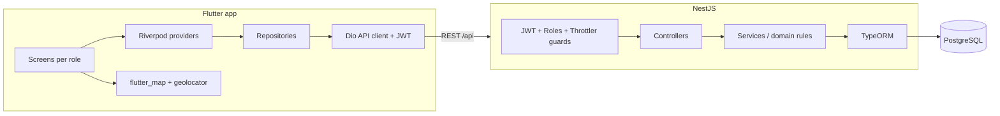

# Essentially

**A location-based marketplace for essential home services** — gas, water, electricity, internet, satellite, solar, plumbing and maintenance.
Customers find trusted providers near them, providers manage priced services and incoming jobs, and administrators moderate the platform.

Flutter (web · Android · iOS) + NestJS REST API + PostgreSQL.

---

## Features

### 👤 Customer
- Browse services **sorted by real distance** from your GPS position, saved home address, or any point picked on the map
- Filter by category, search radius (5–100 km), keyword, and sort by distance / price / rating
- List view and interactive **map view** with your search radius
- Service details with provider profile, service area, verified reviews
- Send requests with a preferred date, address and note — warned if you are outside the provider's service area
- Track requests (pending → accepted → completed), cancel, and **review** completed jobs
- **Report** services, providers or abusive reviews

### 🧰 Service provider
- Dashboard with KPIs: new requests, active jobs, revenue, rating, acceptance rate, live services
- Create / edit / pause / delete services with **title, price (fixed · hourly · monthly), category, location and service radius**
- **Accept or decline** requests (with a reason shown to the customer), mark jobs completed, cancel when needed
- Public business profile with bio, ratings and completed jobs

### 🛡️ Administrator
- Platform overview: users by role, restricted accounts, live/removed services, request funnel, report outcomes
- **Report queue** (oldest first) highlighting repeat offenders and prior warnings
- Resolve reports with an action: **dismiss, warn, remove service, hide review, suspend (N days) or ban**
- Manage users and services directly; restore removed services and reactivate accounts
- Immutable **audit log** of every moderation decision
- Enforcement is immediate: suspended/banned users are rejected on their very next request, banned accounts' open jobs are cancelled, removed services disappear from search and their pending requests are cancelled

## Architecture



| Layer | Highlights |
|---|---|
| **API** | NestJS 12 (ESM), TypeORM, JWT auth (Passport), role-based guards, class-validator DTOs, Swagger/OpenAPI, Helmet, rate limiting, soft deletes, transactional moderation with audit trail |
| **Geo search** | Bounding-box pre-filter in SQL (index-friendly) + exact haversine distance in the service layer, sorted and paginated. Works on any SQL database; PostGIS is a drop-in upgrade path |
| **Domain rules** | Explicit request state machine (who can move a request where), price snapshot at request time, one review per completed job, duplicate-request and duplicate-report protection, ratings recalculated when reviews are hidden |
| **Client** | Flutter 3.32, Riverpod 3, go_router with role-based redirects and deep links, Dio, dark Material 3 design system, adaptive layout (bottom bar on phones, navigation rail on tablets and web) |
| **Quality** | 45 backend tests (unit + full end-to-end flow across all three roles), Flutter unit + widget tests, strict TypeScript, zero analyzer warnings |

## Getting started

### Prerequisites
- Node.js 20+
- Flutter 3.32+
- PostgreSQL 14+ (or Docker) — SQLite works for a zero-setup local run

### 1. API

```bash
cd backend
npm install
cp .env.example .env        # set DB_PASSWORD and JWT_SECRET
npm run seed                # builds, creates tables + demo data
npm run start:dev           # http://localhost:3000/api  ·  Swagger: http://localhost:3000/docs
```

> No PostgreSQL handy? Set `DB_TYPE=sqlite` in `.env` and everything runs against a local file.
> Or run the API and database together with `docker compose up --build` from the repository root.

### 2. App

```bash
flutter pub get
flutter run -d chrome                   # web
flutter run -d emulator-5554            # Android emulator (uses http://10.0.2.2:3000/api)
flutter run --dart-define=API_URL=http://192.168.1.20:3000/api   # physical device on your LAN
```

### Demo accounts

| Role | Email | Password |
|---|---|---|
| Customer | `user@essentially.app` | `Demo@1234` |
| Provider | `provider@essentially.app` | `Demo@1234` |
| Admin | `admin@essentially.app` | `Admin@12345` |

The login screen has one-tap buttons for each. The seed data includes providers across Beirut, Metn, Keserwan and Tripoli, requests in every state, reviews, and three open reports against a suspicious provider for the moderation queue.

## Testing

```bash
cd backend
npm test            # unit tests (geo maths, request state machine)
npm run test:e2e    # end-to-end: auth → services → nearby search → request lifecycle → reviews → reports → moderation
npm run lint

cd ..
flutter analyze
flutter test        # route guards, validators, JSON parsing, app boot
```

## API overview

Full interactive documentation is served at **`/docs`** (Swagger UI).

| Area | Endpoints |
|---|---|
| Auth | `POST /auth/register` · `POST /auth/login` |
| Account | `GET/PATCH /users/me` · `PATCH /users/me/location` · `PATCH /users/me/password` |
| Catalogue | `GET /categories` · `GET /services?lat&lng&radiusKm&categoryId&q&sort` · `GET /services/:id` · `GET /providers/:id` · `GET /reviews` |
| Provider | `GET /services/mine` · `POST/PATCH/DELETE /services/:id` · `PATCH /services/:id/status` · `GET /requests/stats` |
| Requests | `POST /requests` · `GET /requests` · `PATCH /requests/:id/{accept,reject,complete,cancel}` |
| Trust & safety | `POST /reviews` · `POST /reports` · `GET /reports/mine` |
| Admin | `GET /admin/stats` · `GET /admin/reports` · `POST /admin/reports/:id/resolve` · `GET /admin/users` · `PATCH /admin/users/:id/status` · `POST /admin/users/:id/warn` · `GET /admin/services` · `PATCH /admin/services/:id/{remove,restore}` · `PATCH /admin/reviews/:id/hide` · `GET /admin/audit-log` |

## Project structure

```
essentially/
├── lib/                         Flutter client
│   ├── core/                    config, networking, router, theme, shared widgets
│   ├── data/                    models + repositories (one per API area)
│   └── features/
│       ├── auth/                splash, login, register, session controller
│       ├── customer/            explore (list + map), service details, requests, reviews
│       ├── provider/            dashboard, jobs, services, service form
│       ├── admin/               overview, reports, users, services, audit log
│       └── common/              profile, location picker, report sheet
├── backend/                     NestJS API
│   ├── src/
│   │   ├── auth/ users/ categories/ listings/ requests/ reviews/ providers/ reports/ admin/
│   │   ├── common/              guards, decorators, enums, geo utils, pagination
│   │   ├── config/              env validation, database options
│   │   └── database/            bootstrap (admin + categories) and demo seed
│   └── test/                    end-to-end tests
└── docker-compose.yml           API + PostgreSQL
```

## Design decisions

- **Moderation is transactional and audited.** Every admin action and its side effects (cancelling requests, recalculating ratings, closing the report) run in one transaction together with the audit-log write, so the trail can never drift from the data.
- **Bans take effect immediately.** The JWT strategy reloads the account on every request instead of trusting token claims, and expired suspensions lift themselves automatically.
- **Admins cannot be created through the API.** Registration only allows customer or provider; the first admin is bootstrapped from environment variables.
- **Soft-deleted services** keep historical requests and reviews intact.
- **Privacy by default.** Public endpoints expose only safe provider fields; customer contact details are shown to a provider only for requests sent to them.

## Author

**Ahmad Mokdad** — Capstone project.
